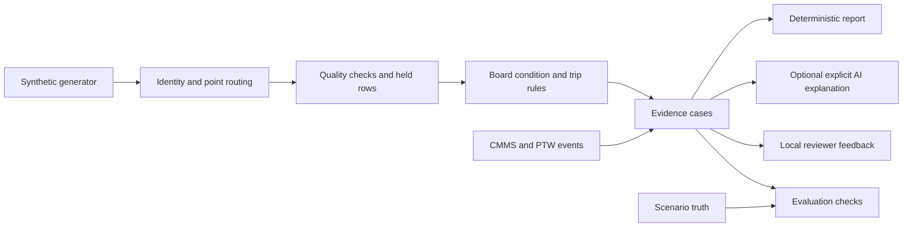

# Architecture and decisions

SignalDesk is a local replay demonstrator. The synthetic generator creates five equipment types. The distribution board `DB-01` and pump `PUMP-01` have explicit demonstration rules and evidence review paths. Other built-in equipment and user-registered assets establish catalogue, point, and ingestion coverage without implying commissioned diagnostic capability.

The generator's truth is separate from detector input. `analyze(readings, events)` receives only observable records. Each case carries exact reading or event IDs, time bounds, severity, a category, human checks, and an AI eligibility reason. The evaluation layer compares results against expectations set independently for each scenario. A passing scenario check measures behavior on these fixtures, not field accuracy.

Identity is explicit: a canonical asset ID represents physical equipment; point IDs and source aliases represent measurements. Unknown or ambiguous references are held for review. A meter and relay can map to the same distribution board while retaining distinct points. Data quality runs before fault inference, so an invalid unit, timestamp, duplicate, or missing feed cannot quietly become an alarm. The board leakage heuristic calibrates from the first 24 hours of accepted running-mode readings and requires a sustained rising window later in running mode. This is a demo rule, not a commissioned threshold or a detector for every operating mode. Units and timestamps are checked per point; `observed_at` and `ingested_at` remain distinct.

CMMS work and PTW records are bounded by event time and linked to the asset. They add context to a case; they do not erase a simultaneous electrical fault or grant work authorization. Source notes are untrusted data. There is no BMS command path or CMMS writeback.

The default report copies detector observations and offers cautious checks. `request_ai_report` is called only by a deliberate UI action for an eligible case. It sends a bounded case payload to an OpenAI-compatible HTTP endpoint, requests JSON, and validates the structure and evidence IDs. The displayed title, observations, measurements, checks, and IDs come from the detector; model output adds only tentative hypotheses without numeric claims. Invalid output, timeout, or absent configuration gives the offline report with a reason. The model has no tools. This validation does not prove semantic correctness; a reviewer must assess all hypotheses.

Feedback is append only in a local SQLite file. Each decision has a timestamp and optional replay context, so two judgments on the same case remain visible. It is not silently reused as a model label or prompt. This replay creates at most one trip case and one qualifying leakage case, so multiple episodes of either pattern are outside its current scope.

The dashboard also generates a separate 90-day synthetic corrective-work history through `demo.history`. pandas DataFrames support asset filtering, weekly reporting and closure counts, fault rankings, and closed-work resolution statistics. History records do not enter `analyze`, influence its baseline, or assert the cause of a current case. See [dashboard design](dashboard-design.md) for chart and measure definitions.

The pump rule requires sustained, timestamp-aligned vibration, bearing temperature and motor current changes against a covered pump-specific running baseline. A legitimate load-change control raises current and pressure without qualifying that combined rule. Insufficient baseline produces an explicit abstention. [Pump walkthrough](pump-walkthrough.md) records the thresholds and limits.

`demo.imports` owns the persistent SQLite asset registry and vendor CSV store. Preview validates identity, timestamps, units, numeric bounds and duplicate/conflicting readings. Save repeats validation in a transaction. The asset view receives an explicit catalogue and sourced records; imported records remain distinct from generated detector evidence. Creating an asset does not modify code or automatically enable a detector. [Import contract](asset-import.md) records the supported format and restart acceptance flow.

`demo.asset_data` joins accepted readings, cases, work orders and valid replay events into one asset bucket. It assesses each expected point against its own cadence at the replay cutoff, so a current meter cannot conceal a stale relay. Its timeline preserves source records and IDs, normalizes maintenance periods, and derives operating-mode transitions from accepted observations. Operating modes are reported context, not verified continuous run feedback. A shared display window filters telemetry and overlapping events; it does not rerun detection or change the current replay status.

`demo.schematics` supplies a Plotly 3D figure per asset. Handcrafted equipment geometry, piping or air paths, electrical routes and sensor markers form independent display layers. Every marker maps to an existing `POINTS` ID. Geometry is illustrative and contains no verified dimensions, plant connections or CAD/BIM import. It has no influence on detection or reporting.

Research rationale: [v0 pre-build research](../../02_Past_Prototypes/predictive-maintainence-legacy/Predictive%20maintainence/raw%20data/research/v0%20pre-build%20research%20and%20risks%202026-10-05.md).
